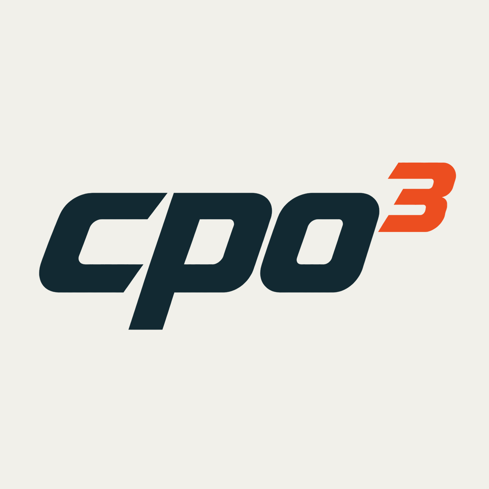

<p align="center">
  <picture>
    <source media="(prefers-color-scheme: dark)" srcset="https://raw.githubusercontent.com/cpo3-org/cpo3/main/assets/logo-dark.png">
    
  </picture>
</p>

# cpo3

cpo3 is a sparse interior-point solver for convex linear and quadratic programs,
written in Rust with a Python interface. It solves

```text
minimize over x, s    ½ xᵀ P x + cᵀ x
subject to           Ax + s = b,  s ∈ K
```

where `P` is symmetric positive semidefinite. The supported cone blocks are
zero cones for equalities and nonnegative cones for inequalities. Thus,
nonnegative-cone rows represent `Ax ≤ b`; variable bounds can be written as
additional constraint rows.

- **Solutions and certificates:** recover primal and dual solutions or
  certificates of primal or dual infeasibility.
- **Warm starts:** supply a previous solution when solving related problems.
- **Sparse linear algebra:** Faer, Apple Accelerate, SuiteSparse CHOLMOD, and Intel MKL PARDISO backends, with
  presolve and Ruiz equilibration.
- **File loading:** read continuous LPs and QPs from MPS and QPS files.

The method uses a regularized homogeneous embedding with a canonical central
path. Its predictor–corrector steps retain the nonlinear embedding equations
while linearizing complementarity.

The name **cpo3** combines *Conic Programming* with **O3**, a double reference to
the compiler optimization flag `-O3` and the trioxide in rust—a nod to its
implementation in Rust.

cpo3 is under active development. The API and solver behavior may change between
releases.

## Installation

The release packages can be installed with:

```sh
python -m pip install cpo3==0.0.1
```

```toml
[dependencies]
cpo3 = "0.0.1"
```

Requires Python 3.10 or later.

For an unreleased checkout, or to customize the build, use the source
installation below.

To build the Python interface from source, install Rust 1.91 or later,
Python 3.10 or later, and [uv](https://docs.astral.sh/uv/), then run:

```sh
git clone https://github.com/cpo3-org/cpo3.git
cd cpo3
uv sync
```

Use `uv run python` from this checkout to run Python with the built package.

To use an unreleased checkout in a Rust application:

```toml
[dependencies]
cpo3 = { git = "https://github.com/cpo3-org/cpo3.git" }
```

## Python quick start

This problem minimizes `½(x₁² + x₂²) − x₁ − 2x₂` subject to
`x₁ ≤ 3` and `x₂ ≤ 4`. The solution is `x = (1, 2)`, with objective `−2.5`.

```python
import cpo3
import numpy as np
from scipy import sparse

problem = cpo3.Problem(
    P=sparse.eye(2, format="csc"),
    c=np.array([-1.0, -2.0]),
    A=sparse.eye(2, format="csc"),
    b=np.array([3.0, 4.0]),
    cones=[cpo3.NonnegativeCone(2)],
)
solution = cpo3.solve(problem)
print(solution.status)

if solution.status == cpo3.SolverStatus.SOLVED:
    print(solution.x)  # approximately [1.0, 2.0]
    print(solution.info.pobj)  # approximately -2.5
```

Use SciPy sparse matrices for `P` and `A`, and set `P=None` for an LP.
Cone blocks correspond to consecutive rows of `A` and `b`; their dimensions must
sum to the number of constraints. Use `cpo3.ZeroCone(dim)` for equality rows.

Pass options through `Settings`:

```python
settings = cpo3.Settings(verbose=True, time_limit=30.0, threads=1)
solution = cpo3.solve(problem, settings=settings)
```

`verbose=True` prints progress and a termination summary. `threads=1` selects
sequential factorization and solves; the default, `threads=0`, uses the backend's
automatic thread selection. See the
[`Settings` docstring](https://github.com/cpo3-org/cpo3/blob/main/python/cpo3/settings.py) for the available controls.

For a related problem, pass `warm_start=(solution.x, solution.y, solution.s)`
to `solve`. The solver screens the point before deciding whether to use it.
Load a problem from disk with `cpo3.io.read_mps("problem.mps")`.

## Rust quick start

The same problem in Rust:

```rust
use cpo3::{Cone, CscMatrix, Problem, Settings, SolverStatus, solve};

fn main() -> Result<(), Box<dyn std::error::Error>> {
    let problem = Problem::new(
        Some(CscMatrix::identity(2)?),
        vec![-1.0, -2.0],
        CscMatrix::identity(2)?,
        vec![3.0, 4.0],
        vec![Cone::Nonnegative(2)],
    )?;
    let solution = solve(&problem, &Settings::default())?;
    println!("{:?}", solution.status());

    if solution.status() == SolverStatus::Solved {
        println!("{:?}", solution.x()); // approximately [1.0, 2.0]
    }
    Ok(())
}
```

Run numerical workloads with `cargo run --release`. Enable the `mps` Cargo
feature to read MPS and QPS files. Use `solve_from` with a `WarmStart` to supply a
starting point for a related problem.

## Optional factorization backends

Faer is always included and needs no external numerical runtime. The published
wheel builds include the following integrations:

| Wheel platform | Included backend integrations |
| --- | --- |
| Linux x86-64 and Windows x86-64 | Faer, CHOLMOD, PARDISO |
| macOS Intel and Apple Silicon | Faer, Accelerate, CHOLMOD |

Accelerate uses the macOS system framework. CHOLMOD and MKL are **not bundled**;
install compatible shared runtimes separately before selecting those backends.
Importing cpo3 and using Faer work without either runtime. Check availability
with `cpo3.LinearSolver.CHOLMOD.is_available()` (or another enum member).

Source builds, including installation from the sdist, default to Faer. Python
source builds also enable MPS/QPS loading. Enable other backends explicitly:

| Backend | Build feature | Requirements |
| --- | --- | --- |
| Apple Accelerate | `accelerate` | macOS 13 or later; `threads=0` required |
| SuiteSparse CHOLMOD | `cholmod` | CHOLMOD 5.2.x or 5.3.x, development headers for source builds only |
| Intel MKL PARDISO | `pardiso` | Intel oneMKL shared runtime |

For example, build from a checkout with Accelerate and start Python:

```sh
uv sync --config-setting "build-args=--features=python,mps,accelerate"
uv run --no-sync python
```

The `--no-sync` option preserves your selected build. To solve the problem
from the Python quick start with Accelerate:

```python
import cpo3

if cpo3.LinearSolver.ACCELERATE.is_available():
    settings = cpo3.Settings(linear_solver=cpo3.LinearSolver.ACCELERATE, threads=0)
    solution = cpo3.solve(problem, settings=settings)
```

Replace `accelerate` with `cholmod` or `pardiso` to build another backend;
features can be combined. Rust applications enable these features in their
Cargo dependency. Equality-only problems always use Faer.

For CHOLMOD, install SuiteSparse with `brew install suite-sparse` (macOS),
`sudo apt-get install libsuitesparse-dev` (Ubuntu), or
`conda install -c conda-forge suitesparse` (Conda). Check that the installed
CHOLMOD version is supported. Set
`CHOLMOD_INCLUDE_DIR` to the directory containing `cholmod.h` unless `pkg-config`
can find it. If runtime discovery fails, set `CPO3_CHOLMOD` or `CPO3_MKL_RT` to
the shared library's full path before starting Python; its dependencies must
also be discoverable by the system loader.

## Understanding results

Always check the termination status before interpreting the returned vectors.

| Status | Meaning |
| --- | --- |
| `solved` | A solution satisfies the feasibility and duality-gap tolerances. |
| `primal_infeasible` | A certificate of primal infeasibility was found. |
| `dual_infeasible` | A certificate of dual infeasibility was found. |
| `max_iterations` | The iteration limit was reached. |
| `time_limit` | The time limit was reached. |

For a solved problem, `x` contains primal variables, `y` dual multipliers, and `s`
constraint slacks. For primal infeasibility, `y` contains the certificate; for
dual infeasibility, `x` and `s` contain the certificate direction. A limit status
does not certify optimality or infeasibility.

`solution.info` includes objectives, residuals, elapsed time, iteration counts,
and linear-algebra statistics. Numerical failures raise `RuntimeError` in Python
or return `SolveError` in Rust.

## Development

After installing the checkout:

```sh
cargo test --features mps
uv run --no-sync pytest -ra
cargo fmt --check
cargo clippy --all-targets --features python,mps -- -D warnings
uv run --no-sync ruff check .
uv run --no-sync ruff format --check .
uv run --no-sync ty check
```

Python tests exercise all available backends and skip unavailable ones. The release
workflow builds wheels from the sdist and runs these tests against installed
wheels outside the checkout, with and without optional native runtimes.

See the [changelog](https://github.com/cpo3-org/cpo3/blob/main/CHANGELOG.md).

See [benchmarks/README.md](https://github.com/cpo3-org/cpo3/blob/main/benchmarks/README.md) for the benchmark data.

## Authors and license

Matteo Santamaria, Michael Cummins, and Brendan O'Donoghue.

Licensed under [MIT](https://github.com/cpo3-org/cpo3/blob/main/LICENSE).
