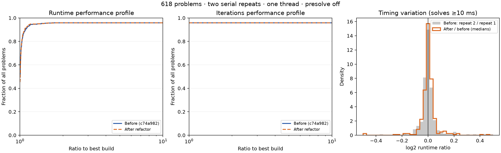

# First-pass refactor: numerical and performance comparison

The refactor preserves the default solver's numerical behavior on all 618
local benchmark problems. The iteration profiles coincide, and the runtime
profiles show no material regression relative to observed timing variation.
This comparison is against commit `c74a982ad1c3fd1dafcfb0f3d963522339becc56`
on `spherical-renormalization`.

## Scope and method

The baseline has its governor disabled and its additional centrality-corrector
budget set to zero, as in its defaults. Both builds retain CVXOPT initialization
and use `sigma = (1 - alpha_affine)^3`. The paper's centering formula is awaiting
the author's separate update.

Both revisions were built in release mode with identical locked dependencies,
toolchain, features (`python,mps`), and linker arguments. Separate persistent
Python workers loaded the two extensions. Solves ran serially with one numerical
thread, alternating build order, after a small unmeasured warm-up. Each problem
was solved twice per build: 2,472 runs and 1,236 paired comparisons.

The timed suite uses the default tolerances, `max_iters=100`, `presolve=False`,
and a 60-second solver limit. An external 120-second limit covers loading,
solving, and verification; no final run hit that external limit. Solver timing
excludes input loading and independent verification. The solver checks its
time limit between iterations, so a long iteration can overrun 60 seconds.

The collection comprises 16 Kennington, 137 Maros–Mészáros, 219 MIPLIB,
98 Netlib, 16 QPLIB, 64 MPC, and 68 DC-OPF problems. MIPLIB inputs are solved
as their continuous relaxations. All failures remain in the profile denominator.
A solution counts as successful only if its independently computed relative
KKT and cone residuals are at most `1e-6`.

## Numerical results

Both builds have identical status and verification results on every run:

| Outcome per build | Problems |
| --- | ---: |
| Solved and independently verified | 593 |
| Iteration limit | 18 |
| Time limit | 7 |
| Total | 618 |

All 1,222 pairs without a time limit match exactly in solution-vector hashes,
hexadecimal objectives and residuals, iterations, factorizations, primary
solves, refinement counters, and initialization flags. Ten of the 14
time-limited pairs also match exactly. Four pairs stop at different iteration
counts, on these three problems:

| Problem | Baseline iterations, repeats 1 / 2 | Refactor iterations, repeats 1 / 2 |
| --- | ---: | ---: |
| `miplib/ns1116954` | 13 / 13 | 12 / 13 |
| `miplib/ns1644855` | 4 / 4 | 3 / 4 |
| `miplib/physiciansched3-3` | 9 / 10 | 10 / 9 |

These pairs are explicitly recorded as time-censored in `summary.json`.
They remain failures in the original timed profiles.

Each of these three problems was then replayed with an identical iteration
cap for both builds (13, 4, and 10 respectively) and a 600-second time limit.
All three pairs reached their iteration caps and matched exactly in every
recorded non-timing field. This confirms that the earlier differences came
from stopping the same numerical trajectories at different iterations.
The [fixed-iteration replay records](capped-replays.json) are supplementary
evidence; they do not replace any timed profile result.

An additional 30 paired checks covered ten representative problems with
presolve enabled, CVXOPT initialization enabled, and both enabled. All 30
solved and matched exactly in every recorded non-timing field; 20 actually
used CVXOPT initialization. The problems, settings, and results are retained
in [modes.json](modes.json). These checks are separate from the timed profiles.

## Runtime results

The median after/before runtime ratio over all 593 commonly verified problems
is **1.00161** (+0.16%). For the 335 problems taking at least 10 ms in both
builds, the median ratio is **1.00200** (+0.20%), with a deterministic
problem-bootstrap 95% interval of **[0.999918, 1.004136]**.

For those longer solves, the 10th–90th percentile runtime-ratio range is
**[0.9721, 1.0326]**, compared with **[0.9697, 1.0337]** for the baseline's
second run divided by its first. The measured changes are comparable to
ordinary repeat variation. Winner fractions at ratio 1 are sensitive to
small timing fluctuations; the curves need not coincide exactly there.

The iteration profiles are identical. Both runtime profiles reach the same
verified-solve fraction, **593/618 = 95.95%**. The
[collection-specific profiles](profiles-by-dataset.png) include all cases,
including sub-10-ms solves with proportionally noisier timings.

This is evidence for no material change in these local profiles, not a claim
of identical runtimes on every instance. It does not reproduce historical
cluster measurements or configurations that enabled the removed features.

## Evidence and reproduction

- [Summary](summary.json): status counts, exact comparisons, censoring, and timing statistics.
- [Compressed run records](results.jsonl.gz): all 2,472 final records.
- [Manifest](manifest.json): settings, problem checksums, and binary checksums.
- [Build provenance](provenance.json): baseline revision, toolchain, dependency hash, and candidate source hashes.
- [Vector profile figure](profiles.svg).
- [Harness and reproduction instructions](../README.md).

Initial gzip-loader errors were corrected before the native MPS suite was
run. The append-only working log retains those attempts; the archived records
contain the latest valid run for each key. Analysis checked that all requested
runs were present and that no unresolved harness errors, worker failures,
or external timeouts remained.

Validation also passed 113 Rust tests, 70 Python tests, Clippy with warnings
denied, Rust formatting, Ruff, Python type checking, and Git whitespace checks.
The candidate source hashes and installed extension were checked against the
benchmarked build.
