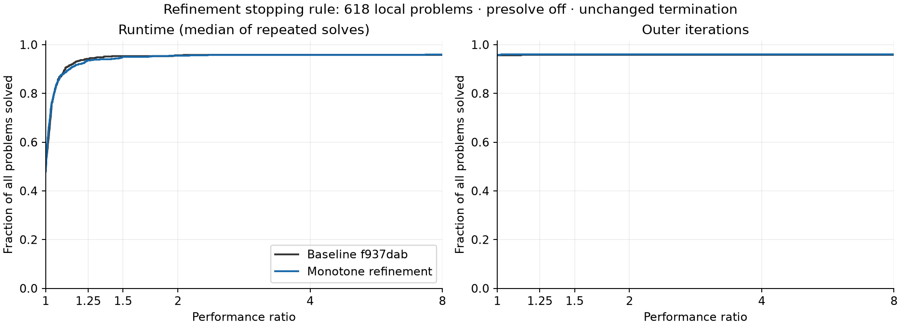

# Iterative refinement reassessment

The proposed change replaces the two-pass convergence forecast and tenfold
error-growth threshold with a single stopping rule: continue only while the
fixed-normalizer backward error strictly decreases. Accept at the existing
refinement tolerance. If error stagnates, increases, or becomes nonfinite, use
the existing non-convergence response. The existing correction budget also
still applies.

Strict mode reports failure to the existing shift-retry mechanism. The final
best-effort attempt returns its best finite iterate. This change does not alter
the retry schedule, refinement tolerance (1e-7), correction budget (30), outer
termination criteria, initialization, or centering. It adds no tuning constants.
It can perform fewer corrections on stagnation and more corrections when slow
initial progress subsequently accelerates; it is not a universal work reduction.

## Baselines and scope

The broad experiment compares commit `f937dabd37acfbc48ef04d285dd45bfb1c84aeb8`
with that exact commit plus the refinement rule. During that experiment, the
branch acquired commit `370a9472ba1ef3a001a71c91e0a3f3a98d894a02`, which reuses
reconstruction scratch storage. A separate integration comparison uses
`370a947` on **both** sides, adding only the refinement patch to the candidate.
Do not interpret the broad experiment as a full-corpus comparison on `370a947`.

`monotone.patch` records the first experimental implementation used in the broad
run. `candidate.patch` removes redundant branches from that implementation and
adds focused tests; it is the retained production patch. Both have the same
numerical behavior on the confirmation sample. `best_effort.patch` records the
rejected alternative of bypassing strict refinement acceptance on all attempts.
The patches apply independently to the baseline, not cumulatively.

## Evidence

| Experiment | Cases | Measured repeats | Candidate/baseline geometric mean time |
| --- | ---: | ---: | ---: |
| Broad corpus, four concurrent single-thread solves | 618 | 2 | 1.0070 |
| Isolated confirmation, one solve at a time | 81 | 3 | 1.0033 |
| Long balanced control, including changed trajectories | 8 | 9 | 0.9976 |
| Small-problem balanced control | 17 | 9 | 1.0021 |

All rows above use `f937dab` as baseline. The updated-base integration results
are recorded separately in `results/head-confirmation.jsonl.gz` and its summary. The
81-case updated-base comparison completed with 81/81 successes on both sides
and a geometric mean time ratio of **0.9957** (candidate 0.4% faster). No case
was more than 5% slower. All 486 measured updated-base records exactly matched
the corresponding earlier variant in vectors, residual metrics, and work
counters; allocation reuse changed none of those numerical results.

[Updated-base runtime and iteration profiles](results/head-profiles.png) compare
`370a947` directly against `370a947` plus the refinement patch.

Every baseline success was retained in the broad run. Baseline solved 592/618
in every measured repeat; candidate solved 593/618. The difference was
QPLIB_10038 crossing the 60-second limit in one baseline repeat. A separate
600-second serial replay solved it in both variants, with 43 iterations and
30.72 versus 31.07 seconds. This is not evidence of an algorithmic success gain.

The broad runtime profiles are close but cross: this is evidence of comparable
performance, not pointwise dominance or a guarantee of no regression. The
candidate is 0.7% slower in the broad geometric mean and 0.3% slower in the
isolated confirmation. Large apparent slowdowns were not reproduced in the
long balanced controls. Those controls also reran the *identical baseline
binary* under a second label: its ratios were 1.0031 on the eight longer cases
and 0.9980 on the 17 small cases. Small differences should not be overinterpreted.

Selected changes in work on successfully solved cases:

| Problem | Outer iterations, before → after | Refinement solves, before → after |
| --- | ---: | ---: |
| MIPLIB traininstance6 | 26 → 26 | 46 → 29 |
| Netlib D6CUBE | 18 → 18 | 4 → 1 |
| Netlib CYCLE | 76 → 67 | 520 → 581 |
| Netlib PILOT4 | 51 → 52 | 325 → 304 |

Returning best effort immediately on every attempt was rejected. It retained
the screening success count but caused substantial trajectory regressions:
CONT-101 went from 13 to 46 iterations, cbs-cta from 14 to 47, and FFFFF800 from
36 to 86. The existing distinction between strict attempts and the final
best-effort attempt is therefore retained.



[Profiles by collection](results/profiles-by-dataset.png) show the original broad
run, including its noisy timings and the QPLIB timeout. The deadline replay is
stored separately and does not replace any primary measurement.

## Protocol and validation

The manifest contains 68 DC OPF, 16 Kennington, 137 Maros–Mészáros, 219 MIPLIB,
64 MPC, 98 Netlib, and 16 QPLIB problems. Known infeasible benchmark sets are
excluded. Presolve is disabled, outer tolerances retain their 1e-8 defaults,
refinement tolerance is 1e-7, and max_iters is 100. Broad runs use a 60-second
solver limit; isolated confirmation and control runs use 600 seconds. Native
`solved` status determines success, without independent solution verification.

The broad run uses four workers, each restricted to one numerical thread.
Variant ordering is alternated. Small problems are batched, with problem timing
taken as the median across repeated batch averages. Confirmation runs are
serial with a per-problem warm-up. The longer controls rotate and reverse
three-variant ordering, including an identical-binary control. Failures remain
in the Dolan–Moré denominator. A variant must solve all measured repeats for a
problem to count as solved. Geometric means include only common successes.

Both the final candidate on `f937dab` and the integrated candidate on `370a947`
passed 87 Rust unit tests, 16 Rust interface tests, and 70 Python tests. Tests
cover immediate stagnation, mild deterioration with recovery of the best
iterate, slow progress that later accelerates, and existing failure counters.
Formatting and whitespace checks also pass. Source and native binary provenance,
raw compressed measurements, test logs, and summaries are in `results/`.

## Reproduction

Use the local benchmark Python environment with NumPy, SciPy, and the benchmark
harness installed, plus the Rust offline dependencies. The saved manifest uses
absolute paths to the existing local corpus; relocate those paths if needed.
The preparation script builds isolated packages without changing the checkout.
On macOS, for example:

```sh
python benchmarks/refinement/scripts/prepare.py /private/tmp/refinement-rerun --variants baseline,monotone
python /private/tmp/refinement-rerun/driver.py --suite full --name full --variants baseline,monotone --repeats 2 --jobs 4
python /private/tmp/refinement-rerun/analyze.py full
python /private/tmp/refinement-rerun/plot.py full monotone
```

Set `CPO3_BENCH_HARNESS` if the benchmark repository is elsewhere.
`CARGO_TARGET_DIR` may point to an existing cache to avoid duplicating build
artifacts. For the final candidate use `--variants baseline,candidate`. For the
updated-base comparison also pass `--base 370a9472ba1ef3a001a71c91e0a3f3a98d894a02`.
The saved `*-ids.json` files record each confirmation/control selection. Build
artifacts and corpus copies are deliberately omitted from this evidence bundle.
